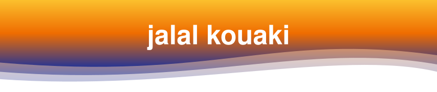
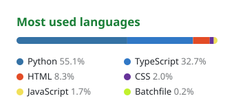
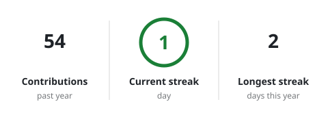
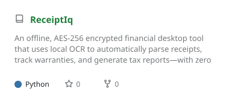
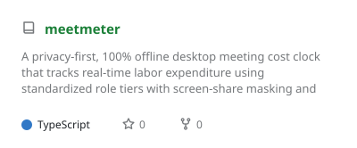
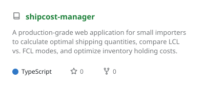
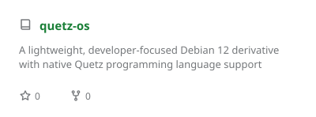
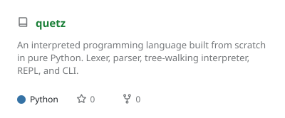
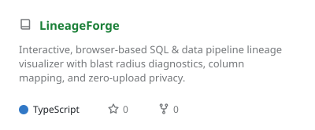

<!-- studio:settings user=jalalkouaki theme=auto hl=2 border=hide light=github-light -->

<!-- studio:header -->
<h1 align="center">Hi, I'm jalal kouaki 👋</h1>

Full-stack developer. I like shipping boring, reliable software.

<!-- studio:banner -->

  <picture>
    <source media="(prefers-color-scheme: dark)" srcset="https://raw.githubusercontent.com/jalalkouaki/jalalkouaki/main/profile-assets/banner-dark.svg?text=jalal%20kouaki&shape=waving&paint=timeGradient&animation=twinkling&section=header&height=180&fontSize=52" />
    
  </picture>

<!-- studio:image -->

  <picture>
    <source media="(prefers-color-scheme: dark)" srcset="https://github.githubassets.com/images/mona-loading-dark.gif" />
    
  </picture>

<!-- studio:split w=a.a -->
<table>
  <tr>
    <td width="50%" valign="top">

### About me
Second-year Business & Marketing student with retail experience and self-taught programming and data analytics skills. Completed a retail operations internship at  Aswak Assalam  (August 2025), using store software to generate price tags, maintain accurate shelf pricing, and support aisle reorganizations that streamlined restocking. Built independent software projects, including an EOQ-based supply chain cost optimizer, a custom Python interpreter, and an offline database verification tool. Fluent in English (EF SET C2 certified), Arabic, and French, with intermediate Spanish and Persian. 
Portfolio: jalalkouaki.co.
email: jalalkouaki@outlook.com

</td>
    <td width="50%" valign="top">

links

Portfolio: https://jalalkouaki.co/

email: jalalkouaki@outlook.com

credly: https://www.credly.com/users/jalal-kouaki

</td>
  </tr>
</table>

<!-- studio:divider -->

<!-- studio:langs+streak -->

  <picture>
    <source media="(prefers-color-scheme: dark)" srcset="https://raw.githubusercontent.com/jalalkouaki/jalalkouaki/main/profile-assets/card-langs-dark.svg?layout=compact&langs_count=8" />
    
  </picture>
  <picture>
    <source media="(prefers-color-scheme: dark)" srcset="https://raw.githubusercontent.com/jalalkouaki/jalalkouaki/main/profile-assets/card-streak-dark.svg" />
    
  </picture>

<!-- studio:stack -->
<h2 align="center">Tools I use</h2>

  <picture>
    <source media="(prefers-color-scheme: dark)" srcset="https://raw.githubusercontent.com/jalalkouaki/jalalkouaki/main/profile-assets/stack-dark.svg?i=py%2Cts&perline=10" />
    
  </picture>

  <b>AI and ML</b> 
  <picture>
    <source media="(prefers-color-scheme: dark)" srcset="https://raw.githubusercontent.com/jalalkouaki/jalalkouaki/main/profile-assets/stack-ai-and-ml-dark.svg?i=pytorch%2Ctensorflow%2Csklearn%2Copencv%2Canaconda%2Cfastapi%2Cjs%2Cjava%2Cnodejs&perline=10" />
    
  </picture>

<!-- studio:divider -->

<!-- studio:repos -->
<h2 align="center">Featured projects</h2>

  <a href="https://github.com/jalalkouaki/ReceiptIq"><picture>
    <source media="(prefers-color-scheme: dark)" srcset="https://raw.githubusercontent.com/jalalkouaki/jalalkouaki/main/profile-assets/card-repo-receiptiq-dark.svg?username=jalalkouaki&repo=ReceiptIq" />
    
  </picture></a>
  <a href="https://github.com/jalalkouaki/meetmeter"><picture>
    <source media="(prefers-color-scheme: dark)" srcset="https://raw.githubusercontent.com/jalalkouaki/jalalkouaki/main/profile-assets/card-repo-meetmeter-dark.svg?username=jalalkouaki&repo=meetmeter" />
    
  </picture></a>
  <a href="https://github.com/jalalkouaki/shipcost-manager"><picture>
    <source media="(prefers-color-scheme: dark)" srcset="https://raw.githubusercontent.com/jalalkouaki/jalalkouaki/main/profile-assets/card-repo-shipcost-manager-dark.svg?username=jalalkouaki&repo=shipcost-manager" />
    
  </picture></a>
  <a href="https://github.com/jalalkouaki/quetz-os"><picture>
    <source media="(prefers-color-scheme: dark)" srcset="https://raw.githubusercontent.com/jalalkouaki/jalalkouaki/main/profile-assets/card-repo-quetz-os-dark.svg?username=jalalkouaki&repo=quetz-os" />
    
  </picture></a>
  <a href="https://github.com/jalalkouaki/quetz"><picture>
    <source media="(prefers-color-scheme: dark)" srcset="https://raw.githubusercontent.com/jalalkouaki/jalalkouaki/main/profile-assets/card-repo-quetz-dark.svg?username=jalalkouaki&repo=quetz" />
    
  </picture></a>
  <a href="https://github.com/jalalkouaki/LineageForge"><picture>
    <source media="(prefers-color-scheme: dark)" srcset="https://raw.githubusercontent.com/jalalkouaki/jalalkouaki/main/profile-assets/card-repo-lineageforge-dark.svg?username=jalalkouaki&repo=LineageForge" />
    
  </picture></a>

<!-- studio:details -->

<b>More about me</b>

- 🌍 Remote, happy to work across time zones
- 📖 Currently reading *Designing Data-Intensive Applications*
- ☕ Fuelled by filter coffee and good code review

<!-- studio:socials -->
<h2 align="center">links</h2>

  
  
  

